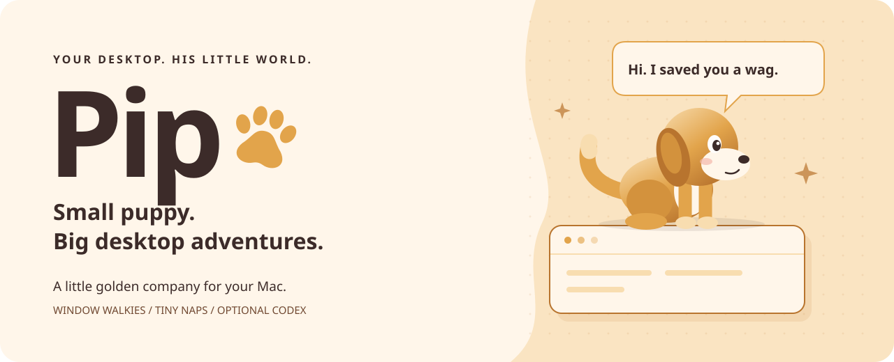

<p align="center">
  
</p>

<h1 align="center">Pip 🐾</h1>
<p align="center"><strong>A little golden company for your Mac.</strong><br />
Walkies between windows. Naps between tasks. A wag saved just for you.</p>

<p align="center">
  <a href="#bring-pip-home">Bring Pip home</a> ·
  <a href="docs/MEET-PIP.md">Meet the puppy</a> ·
  <a href="#a-puppy-with-an-optional-thinking-cap">Codex assistant</a> ·
  <a href="docs/BRAND.md">Brand kit</a> ·
  <a href="docs/ARCHITECTURE.md">Under the fur</a>
</p>

> “Hi. I saved you a wag.” — Pip, when you say hello in his local chat

Pip is a small, animated desktop puppy for **macOS**, built with Electron, TypeScript, Canvas, and a Swift helper. He wanders around your screen, investigates visible windows, follows the cursor, curls up when tired, and occasionally decides that your window ledge is an excellent place for a nap.

His everyday behaviour runs locally. **Codex is optional and off by default.** Connect it when you want project conversations, investigations, and explicitly approved work. Leave it off when you just want a puppy.

## Small dog. Surprisingly full diary.

| Puppy business | What Pip actually does |
| --- | --- |
| 🐕 Walkies | Walks, trots, runs, turns, brakes, hops, and recovers his balance. |
| 🪟 Window expeditions | Chooses visible windows to visit, sniffs frames, watches nearby, and climbs or perches where geometry permits. |
| 👀 Extremely serious noticing | Follows interesting things with his eyes, then his head, then his body. Tiny ear twitches included. |
| 💤 Professional resting | Yawns, stretches, curls up, breathes in his sleep, twitches, and dreams of running. |
| 💛 A whole vocabulary of puppy | Ten ways to sit, lie, or sleep, ten ways to be sad, twenty-five ways to stand, and twenty-five ways to answer a window. |
| ⌨️ Quiet company | Reacts to typing cadence and pauses using aggregate activity counters, without reading the words. |
| 🧠 Little local habits | Learns which activities you encourage and remembers familiar apps and relative resting places. |
| 💬 A paw with your project | With Codex connected, streams answers and handles project tasks through visible approval controls. |

Pip is drawn procedurally, frame by frame. His body, face, paws, ears, and tail form a numeric rig with layered animation and springs. The [animation catalogue](docs/ANIMATIONS.md) lists every clip and which poses he rotates through on his own. The Playground can play the lot.

## Bring Pip home

You’ll need a Mac, Node.js with npm, and Apple’s command-line developer tools (`swiftc` must be available). Node 22 is a suitable starting point for this source checkout. Codex is only needed for the optional assistant.

From the project folder:

```bash
npm install
npm run icons
npm run dev
```

The `predev` script compiles the Swift desktop helper automatically. Pip appears in a transparent window above the desktop; transparent space around him passes clicks through. His menu-bar icon is your home for settings, modes, the Playground, and quitting.

**Your first minute together:**

1. Let Pip settle in. His introduction looks left, looks right, stretches, takes a short walk, and sits again.
2. Click him to open his little chat card. Try `hello`, `good boy`, or `what are you doing?`.
3. Drag him somewhere new. He follows your pointer while held and falls to the desktop or catches a suitable visible window edge on release.
4. Open **Settings** from the menu bar and choose a mode.
5. Open **Playground** to see the puppy repertoire on a simulated desktop.

## Pick today’s flavour of Pip

| Mode | The vibe | The behaviour |
| --- | --- | --- |
| **Chill** · default | Your little desk neighbour | Less energetic and playful, more inclined to settle and snooze. |
| **Playful** | There may be zoomies | Boosts energy, playfulness, curiosity, and excitability; reduces sleepiness. |
| **Focus** | Quiet moral support | Suppresses roaming, cursor chasing, ordinary speech, and assistant suggestions. An explicit copied-text reaction can still speak. |
| **Sleep** | Currently out of paw-fice | Prioritises sleep and suppresses ordinary distractions and assistant suggestions. |

Settings exposes eight personality sliders: **Playfulness, Curiosity, Energy, Attention frequency, Independence, Sleep frequency, Sociability, and Excitability**. Modes bias the saved personality without overwriting your sliders. The core also has a confidence trait, used for desktop decisions, which is not a Settings slider.

You can adjust size, sound effects, animation quality, cursor following, window climbing, visit frequency, multi-monitor roaming, fullscreen hiding, and launch at login. Sound effects start **off**.

## How to speak puppy

Pip’s local chat uses a small set of phrase rules. These are actual replies from the app; wording and matching are intentionally simple.

| Say this in his click-open chat card | Pip says |
| --- | --- |
| `hello` | “Hi. I saved you a wag.” |
| `good boy` | “That one got the whole tail.” |
| `what are you doing?` | “Mostly sitting, watching the room, and trying not to nap on the keyboard.” |
| `I'm tired` | “I could curl up. Wake me if you need a paw.” |

Want him to react to words from another app? **Copy the text yourself**, then choose **React to copied text** from Pip’s card, the menu bar, or Settings. A success such as `tests passed` gets “That deserves a tail wag!”; `I'm stuck` gets “That looks like a tricky bit. I'm here with you.”; `walkies` gets “Did somebody say play?”

This action reads at most 4,000 characters once, reacts locally, and does not save, echo, or send the copied text to Codex. Ordinary typing reactions only know the rhythm. Pip cannot infer what you are writing from it.

For the full character field guide, including his body language, moods, attention span, and response examples, see **[Meet Pip](docs/MEET-PIP.md)**.

## Good habits, tiny steps

After Pip chooses an activity, click him and use **More of that** or **Not that** within **30 seconds**. Feedback gently nudges future activity choices; recent history helps discourage repeats. Modes, explicit actions, and disabled features take priority.

In **Settings → Learning**, inspect encouraged and discouraged activities and run the **animation self-check**. With learning enabled, the first launch without a saved result checks every registered animation through the engine. It keeps only measured improvements to transition timing, bounded to 180–480 ms; pickup, takeoff, and impact timings are excluded.

Learning changes local preferences and animation calibration. It does not retrain a model or rewrite source. The self-check measures pose continuity and playback; judging whether a stretch looks adorable still needs eyes.

**Learn activity preferences** controls both activity learning and animation calibration. Turning off **Remember preferences and resting places** also disables learning. **Clear memory** removes learned preferences, history, resting places, and calibration while preserving Settings and personality sliders. Assistant memory has separate controls.

## A puppy with an optional thinking cap

Choose **Talk to Pip** from the menu bar or Settings to open the conversation popover. Enable **Connect to Codex**, sign in through your installed Codex CLI if needed, and register a project folder for project questions.

```bash
codex login
```

- **Inspect** is for questions and reviews. It checks that the backend can isolate MCP tools; if it cannot, Pip declines to run the inspection.
- **Work** requires explicit permission to start and still respects the configured sandbox and native Codex command/file approvals. The sandbox defaults to **read-only**; choose **workspace-write** when an authorised task needs file changes.
- Conversations support streamed Markdown and code, copy, stop, retry, and resumable history, with distinct general, project, task, and investigation conversations.
- Up to eight tasks can run across different conversations, with one active turn per conversation. Restarted unfinished work is marked interrupted and is not automatically replayed.
- Optional workspace receipts can report test failures, build failures, merge conflicts, and project activity. Suggestions explain their source and wait for your action.

Pip’s assistant is instructed to speak briefly, warmly, and concretely, with enough technical detail when needed. Intentions such as `celebrate`, `investigate`, and `report_problem` connect replies to his existing animations. Codex replies are generated; the local examples above are not promises of exact AI wording.

**Pip stores no API key.** Codex manages its own sign-in, tools, and separate thread history. Enabled assistant requests can send prompts and requested project context through Codex; they are not part of the offline puppy loop. The read-only sandbox prevents writes but is not a filesystem read allowlist confined to the registered folder.

See **[Assistant Brain](docs/ASSISTANT.md)** for setup, permission boundaries, the local event socket, retention limits, and the opt-in live integration test.

## The Playground: puppy rehearsal room

```bash
npm run playground
```

The Playground uses the same drawing code, rig, animation engine, and behaviour pipeline on a **simulated desktop**.

- Search and play clips; pause, loop, or change playback speed.
- Choose a mood and adjust personality sliders.
- Use **Cycle every animation** for a complete catalogue tour.
- Choose **Facing (clip preview) → Left**, **Front**, or **Right**; **Animation direction** restores authored turns.
- Simulate apps opening, windows moving or closing, idle/return events, a fast cursor, typing bursts and pauses, copied success text, Codex outcomes, and denied permission.
- Inspect the decision log for the chosen action, reason, mood, and destination. Simulations are marked `SIM`; live desktop events are marked `os`.
- Use the isolated **Assistant Brain debugger** to simulate projects, tasks, approvals, and connection events without executing real tools or reading projects.

## A respectful little houseguest

| Observation or memory | What to expect |
| --- | --- |
| Windows and apps | The Swift helper uses window geometry, app names, cursor position, and idle time. Desktop awareness and blocked-app controls govern observations. |
| Window titles | Off by default; opt in through Settings. |
| Typing | Aggregate activity and recency only. No key codes, captured text, or persisted typing history. |
| Desktop images | The pet/helper do not take screenshots or record the screen. |
| Character memory | Settings, preferences, position, bounded activity history, and familiar resting places in `pip-state.json`. |
| Assistant memory | Separate `assistant-memory.json` stores bounded conversations, project associations, task records, and suggestions. Persistence can be disabled. |
| Codex history | Managed separately by Codex. Clearing Pip’s assistant memory does not erase it. |

Files live in Electron’s user-data directory, normally `~/Library/Application Support/pip/`. The optional workspace integration uses `assistant.sock` there. Use **Reset environmental memory** to forget familiar places, **Clear memory** for character memory, and **Clear assistant memory** for assistant records after active tasks are stopped.

Pip can walk around without Accessibility or Screen Recording access. Availability of other apps’ window information depends on macOS. If awareness is limited, Pip falls back to screen edges. Optional Codex tools have their own access and approval boundaries; see the [assistant guide](docs/ASSISTANT.md).

## Under the fur

```text
electron/                   Desktop shell, windows, tray, typed preload bridge
native/helper.swift         macOS window and activity observations
src/core/                   Behaviour, needs, attention, movement, world, memory
src/core/animation/         Clips, layered playback, springs, calibration
src/core/assistant/         Projects, conversations, task lifecycle, suggestions
src/renderer/draw/          The actual procedural puppy and effects
src/renderer/pet/           Transparent desktop pet and local chat card
src/renderer/conversation/  Codex conversation popover
src/renderer/settings/      Puppy controls and privacy settings
src/renderer/playground/    Animation previews and simulated desktop
tests/                      Behaviour, geometry, animation, assistant regressions
docs/                       Character guide, branding, architecture, integration
```

The behaviour engine decides **what** Pip wants to do; movement and animation decide **how**; Canvas draws him. The Swift helper runs separately so a helper crash does not take down the puppy. Balanced animation quality slows drawing when Pip rests or sleeps. Everyday decisions never call a model.

Read the [architecture](docs/ARCHITECTURE.md), [animation catalogue](docs/ANIMATIONS.md), or [assistant integration guide](docs/ASSISTANT.md) for deeper details. [Pip.md](Pip.md) is the original product brief, including aspirations; current source is the authority on implemented behaviour.

## Build, check, package

```bash
npm run typecheck
npm test
npm run build
npm run package
```

| Command | Purpose |
| --- | --- |
| `npm run dev` | Compile the Swift helper and start development. |
| `npm run playground` | Compile the helper and start with the Playground open. |
| `npm run build:helper` | Compile the native helper with AppKit, CoreGraphics, and IOKit. |
| `npm run icons` | Generate the application and template tray icons. |
| `npm run build` | Compile the helper and Electron app; app output goes to `out/`. |
| `npm run package` | Build an unsigned macOS application directory under `release/`. |
| `npm run preview` | Preview an existing Electron build. |
| `npm run typecheck` | Run the TypeScript check. |
| `npm test` | Run the Vitest suite; live Codex calls are opt-in. |
| `npm run codegen:codex` | Refresh protocol types using the installed Codex App Server. |

Packaging currently targets a local macOS app directory, not a signed/notarised installer or an automatic update channel. A downloaded unsigned build may need macOS approval before opening. Windows and Linux support are not configured.

### When the puppy needs a little help

- **`swiftc` is missing:** install Apple’s command-line developer tools, then retry. Development and builds compile the native helper.
- **Pip is too curious:** choose Focus, reduce window visit frequency, turn off cursor following, or disable window climbing.
- **He cannot perch somewhere:** window tops need enough headroom and an exposed reachable edge. Maximized windows can receive ground-level visits instead.
- **The assistant is unavailable:** check the Codex status in Settings, your CLI sign-in, executable path, and advertised model; reconnect after correcting them.
- **Inspect cannot isolate tools:** follow the popover’s explanation and the [documented isolation boundary](docs/ASSISTANT.md#read-only-tool-isolation-boundary). A scoped Work request needs explicit approval and retains the selected sandbox.

## Make something tail-wagging

Use the [brand kit](docs/BRAND.md) for Pip’s name, voice, colours, logo, and banner. When changing the puppy, keep decisions in core, joint angles in animation, and drawing in the renderer. Verify behaviour with focused tests and inspect animation changes in the Playground.

This checkout is marked `private` in `package.json` and has no licence file. No open-source licence or public download is claimed here.

---

<p align="center"><strong>Small puppy. Big desktop adventures.</strong><br />
<em>“That one got the whole tail.”</em> 🐾</p>

Pip’s living world now includes intentional investigation, cautious routes, moving-window attachment, long perch rests, stable attention and local resting habits. The playground’s **World source** selects repeatable simulations or the actual desktop pet’s read-only debugger. See [Living desktop behaviour and verification](docs/WORLD.md).

Pip can now roll over, wriggle belly-up, balance on his back paws, do a handstand and dance. Click Pip and choose **Show me a trick** to cycle through them. Playful Pip also shows off occasionally or after enough pats, with room/energy checks and cooldowns. Acrobatics stay on open ground; grabbing him safely interrupts a trick. All five are available in the animation playground.
